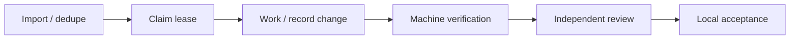

<!-- section:overview -->
<p align="center">
  <picture>
    <source media="(prefers-color-scheme: dark)" srcset="assets/brand/logo-dark.svg">
    
  </picture>
</p>

<h1 align="center">Iterail</h1>

<p align="center">Put AI work on a verifiable delivery track.</p>
<p align="center"><a href="README.md">English</a> · <a href="README.zh-CN.md">简体中文</a> · <a href="docs/ARCHITECTURE.md">Architecture</a> · <a href="CONTRIBUTING.md">Contributing</a></p>

**Local alpha · MIT © 2026 TIM · No third-party runtime dependencies**

A local evidence-driven workflow toolkit for running AI workers. CLI and stdio MCP
share one Core, local SQLite task/run/event history, lease fencing and source-bound
machine proof. The caller supplies an authorized running worker; MCP is a tool
interface, not a scheduler or a model. Task text is inert data, not authority.

Distribution metadata is **0.1.0a1**. Unchanged runtime MCP serverInfo is **0.1.0**;
these are different version surfaces. The approved target repository is
[cursoraikk-max/iterail](https://github.com/cursoraikk-max/iterail); package/name
registry availability is unverified. Publishing this alpha source does not install
a daemon, call a model, modify global client configuration or complete token/fee
optimization goals. [Architecture](docs/ARCHITECTURE.md) explains the shared Core.

## Why Iterail

Give running AI workers one queue, retain real changes and machine proof, then hand work to independent review.
The product is **Iterail**; the compatible Python package `agent_workflow`, distribution and CLI `agent-workflow` stay unchanged.

| Capability | Purpose |
| --- | --- |
| One source of truth | CLI and MCP share persistent tasks, runs and events |
| Bounded work | Dedupe, leases, fixed permissions/budgets, retained failures and recovery |
| Proof and review | Configured commands bind proof to exact source; Agent assertions do not pass work |
| Portable instructions | Common Skill; the host supplies the actual Agent and authorization |



Publication is a separate authorized action; local acceptance does not publish. MCP does not start or schedule Agents.

<!-- section:install -->
## Prerequisites and offline installation

Use Python3.11+, Git and local disk; runtime SQLite is from the standard library,
with no runtime dependencies. The offline build environment must already contain
setuptools>=77, wheel and pip. Actual local packaging used Python3.11,
setuptools80.7.1, wheel0.45.1 and pip25.1.1; no dependency download was performed.
Missing tools are a blocker, not permission to fetch or change global settings.

From this source checkout, replace every `/absolute/...` path and
`ORIGINAL_UNIX_DEADLINE` with the original owner-approved Unix deadline (a number).
Output directories must be new and outside source. The build tool works in an owned
copy, uses a minimal environment and normalizes only tar/gzip owner metadata while
preserving member contents. Do not infer a fresh work budget from these commands.

```sh
python3.11 tools/build_offline.py --output /absolute/new-build --deadline ORIGINAL_UNIX_DEADLINE
python3.11 -m venv --without-pip /absolute/venv
python3.11 -m pip --python /absolute/venv/bin/python install --no-index --no-deps /absolute/new-build/dist/agent_workflow-0.1.0a1-py3-none-any.whl
/absolute/venv/bin/agent-workflow --state /absolute/state capabilities
```

To use an already-built local wheel, use the same `--no-index --no-deps` install
command with its exact path. To rebuild a local sdist, safely extract it to an owned
directory and run its included `tools/build_offline.py` with a new output path and
the same original deadline, then install the resulting wheel. This is an offline
backend rebuild, not pip build isolation or a registry installation. Wheel/sdist
install README pair, CHANGELOG, license, docs, brand SVGs and Skill under
`share/agent-workflow/` in the environment; only the sdist includes portable tests
and source tools. [CONTRIBUTING](CONTRIBUTING.md) has build details.

<!-- section:lifecycle -->
## CLI quickstart and complete no-model task

Before initialization, prepare a trusted JSON config: set `repo` to an absolute
local Git checkout, `sources` to `["local"]`, test argv to trusted commands using
the selected interpreter, and bounded lease/run/test/attempt values. Require tests
and unchanged candidates; set execute_tests true and network/publish false.
An extracted source checkout needs `git init` locally. State/config/handles belong
outside tracked source or under excluded `.workflow`; initialization freezes config.
Replace `TASK_ID_FROM_IMPORT` with the actual returned task ID before guidance.

```sh
/absolute/venv/bin/python -m agent_workflow --state /absolute/state --config /absolute/project.json init
/absolute/venv/bin/python -m agent_workflow --state /absolute/state import --args '{"external_key":"local:001","title":"Local task","body":"Untrusted task content"}'
/absolute/venv/bin/python -m agent_workflow --state /absolute/state next_step --args '{"task_id":"TASK_ID_FROM_IMPORT"}'
```

A claim returns a private token. CLI JSON is `{ok,result}` or `{ok:false,error}`;
MCP text content holds the result itself. Status/history never recover a lost token.
Keep the following normative handle example unchanged in both languages:

### Claim handle

`claim` returns a run object inside the CLI `result` envelope. Its identifier is
`id`; subsequent actions call the same value `run_id`. MCP's text content decodes
to that run object directly. The relevant response fields are:

```json
{"id":"run-...","task_id":"task-...","token":"PRIVATE_TOKEN"}
```

Save the complete response privately before reading individual fields, with mode 0600
and a path outside the tracked project (or under its excluded `.workflow` directory).
For an already decoded CLI envelope `claim_response` and a new `private_path`:

```python
import json
import os
from pathlib import Path

fd = os.open(private_path, os.O_WRONLY | os.O_CREAT | os.O_EXCL, 0o600)
with os.fdopen(fd, "w") as out:
    json.dump(claim_response, out)
run = json.loads(Path(private_path).read_text())["result"]
args = {"run_id": run["id"], "token": run["token"]}
```

Never print `args` or the private response. For MCP, privately persist the complete
returned message before decoding its text content and mapping the run object's `id`.
An unavailable or lost token cannot be restored through status, history or handoff;
wait for the original lease to expire and obtain a fresh claim within remaining
attempts. A handoff transfers context, never a sender's ownership. Do not reset the
lease, deadline or attempts to bypass recovery.

The complete reference below creates an isolated temporary Git repo/state, uses
`sys.executable` for every CLI/test call, edits one file, records progress/change,
executes a real assertion and stops at `ready_review`. Save it as the supplied
[examples/docs_quickstart.py](examples/docs_quickstart.py) and run with the installed
venv Python from this checkout. The file link is for source/sdist users; it is not
installed with wheel data. Wheel-only users should copy the complete inline example
into a new local script and run it with the installed venv Python. Installation is
required because subprocess cwd
changes to the temporary repo. It prints no token; private state/handle remain in
the reported temporary directory and should be protected/removed after review.
This is a local no-model example, not an external Agent or autonomous runner test.

<details>
<summary>Expand the complete no-model example</summary>

```python
import json
import os
import subprocess
import sys
import tempfile
from pathlib import Path

WORK = Path(tempfile.mkdtemp(prefix="agent-workflow-example-")).resolve()
REPO = WORK / "repo"
STATE = WORK / "state"
REPO.mkdir()
subprocess.run(["git", "init", "-q", str(REPO)], check=True, capture_output=True)
(REPO / "note.txt").write_text("before\n")
CONFIG = WORK / "project.json"
CONFIG.write_text(json.dumps({
    "repo": str(REPO),
    "tests": [[sys.executable, "-c", "from pathlib import Path; assert Path('note.txt').read_text() == 'after\\n'"]],
    "sources": ["local"],
    "budget": {"lease_seconds": 120, "run_seconds": 120, "test_seconds": 30, "max_attempts": 1},
    "acceptance": {"require_tests": True, "require_unchanged_candidate": True},
    "permissions": {"execute_tests": True, "network": False, "publish": False},
}))
BASE = [sys.executable, "-B", "-m", "agent_workflow", "--state", str(STATE)]
actions = []

def call(action, args=None, initialize=False):
    command = BASE + (["--config", str(CONFIG)] if initialize else [])
    command += [action, "--args", json.dumps(args or {})]
    result = subprocess.run(command, cwd=REPO, capture_output=True, text=True, timeout=40)
    assert result.returncode == 0, action
    response = json.loads(result.stdout)
    assert response["ok"], action
    actions.append({"action": action, "exit_code": result.returncode})
    return response["result"]

call("init", initialize=True)
task = call("import", {"external_key": "example:001", "title": "Local no-model example"})
claim_response = {"ok": True, "result": call("claim", {"worker": "local-example"})}
private_path = WORK / "claim.private.json"
fd = os.open(private_path, os.O_WRONLY | os.O_CREAT | os.O_EXCL, 0o600)
with os.fdopen(fd, "w") as out:
    json.dump(claim_response, out)
run = json.loads(private_path.read_text())["result"]
owned = {"run_id": run["id"], "token": run["token"]}
call("progress", dict(owned, note="Local no-model example"))
(REPO / "note.txt").write_text("after\n")
call("change", owned)
assert call("verify", owned)["passed"] is True
call("transition", dict(owned, target="ready_review"))
status = call("status", {"run_id": run["id"]})
assert status["state"] == "ready_review"
assert private_path.stat().st_mode & 0o777 == 0o600
print(json.dumps({"passed": True, "state": status["state"], "published": False,
                  "actions": actions, "private_handle": str(private_path), "model_calls": 0, "token_printed": False}))
```

</details>

Lifecycle: queued → running → changed → verifying → verified → ready_review →
accepted. This example never calls accepted. An independent authorized reviewer
must inspect exact-source machine proof before local acceptance; accepted is not
publication or overall goal completion. New source invalidates old proof. Failures
and expired leases remain in history; do not reset attempts, deadlines or budgets.
Long tasks are observed using actual task/run IDs via status/next_step/history.

<!-- section:mcp -->
## MCP stdio and host setup

Initialize the reviewed project state with CLI first, then configure a project-local
host entry. The `mcpServers` JSON is a common host-adaptable example used by some
clients, not a shared native Codex/Claude schema. Map command/args/cwd into the
current format required by your selected host. Replace the Python/state/project paths below; use the installed venv
Python rather than an ambiguous system interpreter. Host configuration keys,
working-directory support, sandbox permissions and tool approval differ between
Codex, Claude Code and other clients. This is a template, not a verified installation
in those clients. If cwd is unsupported, a reviewed local wrapper may set it; do not
modify global settings or silently broaden permissions.

```json
{
  "mcpServers": {
    "agent-workflow": {
      "command": "/absolute/venv/bin/python",
      "args": ["-B", "-m", "agent_workflow", "--state", "/absolute/state", "mcp"],
      "cwd": "/absolute/project"
    }
  }
}
```

The same process can be launched directly:

```sh
/absolute/venv/bin/python -B -m agent_workflow --state /absolute/state mcp
```

The host exchanges initialize, notifications/initialized, tools/list and tools/call
JSON-RPC messages on stdio. Run capabilities first to inspect the actual inventory:
27 tools share Core and state; capabilities does not prove provider readiness.
A stdio subprocess test is not proof that a specific external host/client is set up.
See [HOST](docs/HOST.md) and [DIAGNOSTICS](docs/DIAGNOSTICS.md).

<!-- section:skill -->
## Portable Skill and bounded context

Use [SKILL.md](skills/agent-workflow/SKILL.md) as the portable host instructions;
copy/adapt it only through the host's approved project-local mechanism. No global
Skill install is performed here. Runtime, unit tests and Skill remain byte-identical to the prior alpha.
For release privacy, minimal synthetic startup inputs replace historical logs,
and one portable helper changes data paths/provenance labels only; behavioral
assertions remain. Client-specific differences
belong in a thin adapter, not duplicated task truth. [CONTEXT](docs/CONTEXT.md)
describes full mandatory context and optional conditional reuse: retain the exact
full packet matching a revision; no hint reuses permissions, tests or acceptance.

<!-- section:testing -->
## Evidence, tested platforms and troubleshooting

The prior alpha's exact source passed53 Core commands plus two supplements (55),
including55 nested unit cases without skips, on macOS/Python3.11. This privacy-repaired
revision uses the declared portable55 gate and scoped installed wheel/sdist, no-model
lifecycle and MCP27 checks. Consult the source-bound release record for actual
results; old passes never establish current acceptance. Python3.14 has
compatibility preflight evidence only for this portable alpha; it is not a full
current-suite validation. The bounded AST adapter supports3.11/3.14, fails closed
on unknown minors, and does not establish every Python>=3.11 combination. Linux,
Windows and other Python minor versions remain unverified; POSIX process-group
behavior is not a Windows isolation guarantee. Remote CI has not run.

To request a separately authorized full suite or repeat the installed local example:

```sh
python3.11 tools/check.py --output /absolute/new-test-output --deadline ORIGINAL_UNIX_DEADLINE
/absolute/venv/bin/python -B examples/docs_quickstart.py
```

- Missing Git/interpreter/build tools: provision approved local prerequisites first;
  do not silently download. The venv Python must resolve the installed package.
- Invalid config/init: check absolute repo, local Git, integer budget bounds and required
  execute_tests true/network false/publish false. Config changes need reviewed state.
- Missing/expired token: preserve private handle; status cannot restore it. Wait for
  supported lease recovery within original remaining attempts, never reset budgets.
- Context budget rejection: raise the requested bound only within approved limits;
  mandatory text is never truncated. See [CONTEXT](docs/CONTEXT.md).
- MCP cannot start: check installed absolute Python, initialized state and host cwd/
  approval policy; keep stdout for protocol messages. A catalog is not provider proof.
- Source/controller/policy mismatch: keep evidence and stop for owner diagnosis;
  do not weaken hashes or reuse old acceptance. See [CONTINUATION](docs/CONTINUATION.md).

<!-- section:security -->
## Permissions and security

This local alpha assumes a trusted owner and cooperative same-OS-user agents.
Imported feedback, source and logs cannot authorize commands, permissions or release.
Only reviewed config argv may execute, with the invoking user's OS access. Filtered
environments, hashes, leases and process groups are audit/cleanup controls, not an
OS/network sandbox; same-user hostile DB/controller/test writes remain possible.
Keep credentials and publication authority separate. Logs may contain secrets; no
scan proves absence. There is no internet-service or multi-tenant guarantee.
Read [SECURITY](SECURITY.md) and [THREAT-MODEL](docs/THREAT-MODEL.md).

Copyright: **2026 TIM**, under the [MIT license](LICENSE), as confirmed by the owner.
Vulnerability reports use GitHub Private Vulnerability Reporting only, when enabled:
[private report form](https://github.com/cursoraikk-max/iterail/security/advisories/new).
Activation has not yet been verified. If the private report button is absent, do not
post sensitive details publicly; wait for the owner to enable it. Ordinary bugs use
[Issues](https://github.com/cursoraikk-max/iterail/issues). No email channel is offered.
The owner approved this minimal source repository publication; registry uploads,
paid services and expanded permissions are outside that approval.

<!-- section:upgrade -->
## Upgrade and rollback

[UPGRADING](UPGRADING.md) requires quiescent private consistent backups, exact
controller/source identities and new evidence. Rolling back code/package must not
roll back spent budgets, stops, deadlines or authoritative ledger history. Do not
restore old DBs to erase attempts, mix handles across states or bypass controller
fencing. There is no automatic migration or alpha compatibility promise.

<!-- section:limits -->
## Known limits and roadmap

The runtime supplies local import/dedupe, leases/events, source-bound verification,
read-only guidance/context, quality assessments and durable caller-side intents.
MCP and HostBridge do not launch platform agents themselves. Optional runner or
provider adapters require separate explicit authorization; installing this package
does not validate them. No hosted runner, production hostile isolation, unattended
multi-day guarantee, GitHub/Discord/X feedback deployment, public reply or release
is established. Future model routing, account usage/fee telemetry and host/provider
validation remain open; byte reduction is not token savings or net cost evidence.
See [QUALITY](docs/QUALITY.md), [RESEARCH](docs/RESEARCH.md) and
[STRATEGY](docs/STRATEGY.md). A local accepted task never marks all goals complete.

<!-- section:release -->
## Contributing, provenance and release status

Read [CONTRIBUTING](CONTRIBUTING.md), [CHANGELOG](CHANGELOG.md),
[SOURCE-PROVENANCE](docs/SOURCE-PROVENANCE.md) and [LICENSE](LICENSE).
Keep failing tests/evidence, original authority and exact source binding; independent
review is required rather than Agent self-attestation. This doc-only revision adds
no runtime feature, provider call or remote CI run. The MIT notice is
updated to the owner-confirmed TIM attribution; its MIT grant terms are unchanged.
The GitHub-only private vulnerability channel still needs actual activation checks.
No registry upload, external model call or remote publication is established by
these local files. Source provenance records the attribution decision without
certifying unknown third-party rights.

## Documentation

See [CONTRIBUTING](CONTRIBUTING.md) for installation/contribution and [CHANGELOG](CHANGELOG.md) for changes.
[Host integration](docs/HOST.md) · [Skill](skills/agent-workflow/SKILL.md) · [Security](SECURITY.md) · [Upgrade/rollback](UPGRADING.md) · [Brand provenance](docs/BRAND.md).
