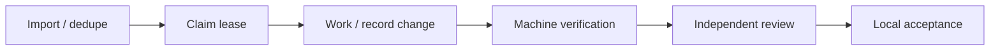

<!-- section:overview -->
<p align="center">
  <picture>
    <source media="(prefers-color-scheme: dark)" srcset="assets/brand/logo-dark.svg">
    
  </picture>
</p>

<h1 align="center">Iterail</h1>

<p align="center">把 AI 工作接到可验证的交付轨道上。</p>
<p align="center"><a href="README.md">English</a> · <a href="README.zh-CN.md">简体中文</a> · <a href="docs/ARCHITECTURE.md">架构</a> · <a href="CONTRIBUTING.md">贡献</a></p>

**本地 alpha · MIT © 2026 TIM · 无运行时第三方依赖**

面向正在运行的 AI worker 的本地证据驱动工作流工具包。CLI 与 stdio MCP 共享同一 Core、
SQLite 任务/run/事件历史、租约围栏与绑定源码的机器证明。调用方提供已授权的 worker；
MCP 是工具接口，不是调度器或模型。任务文字只是数据，不能授予权限。

发行元数据版本为 **0.1.0a1**，未改动的运行时 MCP serverInfo 仍为 **0.1.0**，两者表示不同层面。
已批准的目标仓库是 [cursoraikk-max/iterail](https://github.com/cursoraikk-max/iterail)；
名称或包注册表可用性未验证。发布此 alpha 源码不会安装守护进程、调用外部模型或改变全局客户端
配置，也不代表 token/费用优化目标完成。
共享 Core 的结构见[架构](docs/ARCHITECTURE.md)。

## 一眼了解 Iterail

让正在运行的 AI worker 从同一队列领取工作，记录真实变更和机器验证，再交给独立审查。
品牌名称为 **Iterail**；兼容包名 `agent_workflow`、发行名与 CLI `agent-workflow` 保持不变。

| 能力 | 用途 |
| --- | --- |
| 同一事实来源 | CLI 与 MCP 共享持久任务、run 和事件 |
| 有界执行 | 去重、租约、固定权限与预算，记录失败和恢复 |
| 证据与审查 | 配置命令产生绑定准确源码的证明；Agent 自报不足以通过 |
| 可移植指令 | 通用 Skill；宿主负责实际 Agent 和授权 |



发布是单独的已授权动作；图中的本地验收不会自动发布。MCP 不负责启动或调度 Agent。

<!-- section:install -->
## 前提与离线安装

需要 Python3.11+、Git 和本地磁盘；SQLite 来自标准库，无运行时依赖。
离线构建环境须事先具备 setuptools>=77、wheel 和 pip。本机实际打包使用 Python3.11、
setuptools80.7.1、wheel0.45.1、pip25.1.1，没有下载依赖。缺少工具应先停止并取得合法的本地
前提，不代表允许联网安装或修改全局配置。

从本源码目录运行下列命令。所有 `/absolute/...` 必须替换为实际路径，
`ORIGINAL_UNIX_DEADLINE` 必须替换为 owner 原已批准的 Unix 截止时间数字。
输出目录必须为源码外的新目录。构建工具使用独立副本与最小环境，只规范化 tar/gzip 所有者
元数据，保留成员内容。这些命令不会授予新的工作预算。

```sh
python3.11 tools/build_offline.py --output /absolute/new-build --deadline ORIGINAL_UNIX_DEADLINE
python3.11 -m venv --without-pip /absolute/venv
python3.11 -m pip --python /absolute/venv/bin/python install --no-index --no-deps /absolute/new-build/dist/agent_workflow-0.1.0a1-py3-none-any.whl
/absolute/venv/bin/agent-workflow --state /absolute/state capabilities
```

已有本地 wheel 可直接使用相同 `--no-index --no-deps` 命令和它的准确路径安装。
要重建本地 sdist，先安全解包至独立目录，再运行其中的 `tools/build_offline.py`，使用新输出
路径与同一原截止时间，然后安装产出的 wheel。这是离线后端重建，不是 pip 构建隔离或注册表安装。
wheel/sdist 均把两份 README、CHANGELOG、许可证、docs、品牌 SVG 和 Skill 安装到环境内
`share/agent-workflow/`；只有 sdist 包含便携测试与源码工具。
细节见[贡献指南](CONTRIBUTING.md)。

<!-- section:lifecycle -->
## CLI 快速开始与完整无模型任务

初始化前准备可信 JSON 配置：`repo` 指向绝对路径的本地 Git checkout，`sources` 为 `["local"]`，
测试 argv 使用选定解释器和可信命令，租约/run/测试/尝试次数有界；要求测试与未改变候选源码，
execute_tests 为 true，network/publish 为 false。解包源码须先本地 `git init`。
状态、配置与句柄应在跟踪源码外或被排除的 `.workflow` 下；初始化后配置冻结。
调用指导前，将 `TASK_ID_FROM_IMPORT` 换成实际导入返回的任务 ID。

```sh
/absolute/venv/bin/python -m agent_workflow --state /absolute/state --config /absolute/project.json init
/absolute/venv/bin/python -m agent_workflow --state /absolute/state import --args '{"external_key":"local:001","title":"Local task","body":"Untrusted task content"}'
/absolute/venv/bin/python -m agent_workflow --state /absolute/state next_step --args '{"task_id":"TASK_ID_FROM_IMPORT"}'
```

claim 返回私密 token；CLI 为 `{ok,result}` 或 `{ok:false,error}`，MCP 文本内容直接承载结果。
status/history 不能恢复丢失 token。以下规范句柄段在两种语言中原样保留：

### Claim handle

`claim` returns a run object inside the CLI `result` envelope. Its identifier is
`id`; subsequent actions call the same value `run_id`. MCP's text content decodes
to that run object directly. The relevant response fields are:

```json
{"id":"run-...","task_id":"task-...","token":"PRIVATE_TOKEN"}
```

Save the complete response privately before reading individual fields, with mode 0600
and a path outside the tracked project (or under its excluded `.workflow` directory).
For an already decoded CLI envelope `claim_response` and a new `private_path`:

```python
import json
import os
from pathlib import Path

fd = os.open(private_path, os.O_WRONLY | os.O_CREAT | os.O_EXCL, 0o600)
with os.fdopen(fd, "w") as out:
    json.dump(claim_response, out)
run = json.loads(Path(private_path).read_text())["result"]
args = {"run_id": run["id"], "token": run["token"]}
```

Never print `args` or the private response. For MCP, privately persist the complete
returned message before decoding its text content and mapping the run object's `id`.
An unavailable or lost token cannot be restored through status, history or handoff;
wait for the original lease to expire and obtain a fresh claim within remaining
attempts. A handoff transfers context, never a sender's ownership. Do not reset the
lease, deadline or attempts to bypass recovery.

下面的完整参考示例创建独立临时 Git 仓库和状态，以 `sys.executable` 执行所有 CLI/测试命令，
修改一个文件、记录 progress/change、运行真实断言并停在 `ready_review`。
已提供相同文件 [examples/docs_quickstart.py](examples/docs_quickstart.py)；从本 checkout 用已安装
环境的 Python 运行。该文件链接仅适用于 source/sdist，不随 wheel 数据安装。仅使用 wheel 的
用户应将内联完整示例复制到新的本地脚本，再用已安装 venv 的 Python 运行。
子进程会切换到临时仓库，因此须先安装包。示例不打印 token；私密状态与
句柄留在输出的临时目录内，审查后应妥善保管或清理。它是本地无模型示例，不是外部 Agent
或无人值守 runner 的接入证明。

<details>
<summary>展开完整无模型示例</summary>

```python
import json
import os
import subprocess
import sys
import tempfile
from pathlib import Path

WORK = Path(tempfile.mkdtemp(prefix="agent-workflow-example-")).resolve()
REPO = WORK / "repo"
STATE = WORK / "state"
REPO.mkdir()
subprocess.run(["git", "init", "-q", str(REPO)], check=True, capture_output=True)
(REPO / "note.txt").write_text("before\n")
CONFIG = WORK / "project.json"
CONFIG.write_text(json.dumps({
    "repo": str(REPO),
    "tests": [[sys.executable, "-c", "from pathlib import Path; assert Path('note.txt').read_text() == 'after\\n'"]],
    "sources": ["local"],
    "budget": {"lease_seconds": 120, "run_seconds": 120, "test_seconds": 30, "max_attempts": 1},
    "acceptance": {"require_tests": True, "require_unchanged_candidate": True},
    "permissions": {"execute_tests": True, "network": False, "publish": False},
}))
BASE = [sys.executable, "-B", "-m", "agent_workflow", "--state", str(STATE)]
actions = []

def call(action, args=None, initialize=False):
    command = BASE + (["--config", str(CONFIG)] if initialize else [])
    command += [action, "--args", json.dumps(args or {})]
    result = subprocess.run(command, cwd=REPO, capture_output=True, text=True, timeout=40)
    assert result.returncode == 0, action
    response = json.loads(result.stdout)
    assert response["ok"], action
    actions.append({"action": action, "exit_code": result.returncode})
    return response["result"]

call("init", initialize=True)
task = call("import", {"external_key": "example:001", "title": "Local no-model example"})
claim_response = {"ok": True, "result": call("claim", {"worker": "local-example"})}
private_path = WORK / "claim.private.json"
fd = os.open(private_path, os.O_WRONLY | os.O_CREAT | os.O_EXCL, 0o600)
with os.fdopen(fd, "w") as out:
    json.dump(claim_response, out)
run = json.loads(private_path.read_text())["result"]
owned = {"run_id": run["id"], "token": run["token"]}
call("progress", dict(owned, note="Local no-model example"))
(REPO / "note.txt").write_text("after\n")
call("change", owned)
assert call("verify", owned)["passed"] is True
call("transition", dict(owned, target="ready_review"))
status = call("status", {"run_id": run["id"]})
assert status["state"] == "ready_review"
assert private_path.stat().st_mode & 0o777 == 0o600
print(json.dumps({"passed": True, "state": status["state"], "published": False,
                  "actions": actions, "private_handle": str(private_path), "model_calls": 0, "token_printed": False}))
```

</details>

生命周期：queued → running → changed → verifying → verified → ready_review → accepted。
示例不调用 accepted。独立且获授权的 reviewer 须检查准确源码的机器证明后才可本地验收；
accepted 不是发布或整体目标完成。新源码使旧证明失效。失败/过期租约保留历史，不能重置尝试
次数、截止时间或预算。长任务按实际 task/run ID 用 status/next_step/history 查询。

<!-- section:mcp -->
## MCP stdio 与宿主配置

先通过 CLI 初始化审阅过的项目状态，再配置项目级 host 入口。替换下面的 Python、状态和项目
路径；`mcpServers` JSON 是部分客户端常见的可适配示例，不是 Codex/Claude 共同原生格式。
应将 command/args/cwd 映射到所选宿主当前要求的格式。使用已安装 venv 的绝对 Python，不要使用含糊的系统解释器。Codex、Claude Code 等宿主
的配置键、cwd 支持、沙箱权限与工具审批方式不同；这只是模板，不代表已在这些客户端完成实际安装。
若 host 不支持 cwd，可使用经审阅的本地 wrapper 设置目录；不要修改全局设置或静默扩大权限。

```json
{
  "mcpServers": {
    "agent-workflow": {
      "command": "/absolute/venv/bin/python",
      "args": ["-B", "-m", "agent_workflow", "--state", "/absolute/state", "mcp"],
      "cwd": "/absolute/project"
    }
  }
}
```

同一进程可直接启动：

```sh
/absolute/venv/bin/python -B -m agent_workflow --state /absolute/state mcp
```

宿主在 stdio 上传输 initialize、notifications/initialized、tools/list、tools/call JSON-RPC。
先调用 capabilities 检查实际清单：27 个工具共享 Core 与状态，但不证明 provider 已就绪。
stdio 子进程测试不是具体外部客户端已配置的证明。
参见 [HOST](docs/HOST.md) 与[诊断](docs/DIAGNOSTICS.md)。

<!-- section:skill -->
## 可移植 Skill 与有界上下文

[SKILL.md](skills/agent-workflow/SKILL.md) 提供可移植宿主指令，仅通过宿主已批准的项目级机制
复制或适配；此处不做全局 Skill 安装。运行时、单元测试与 Skill 保持逐字节一致；为发布隐私将历史启动日志替换为最小合成输入，
一个便携辅助脚本只调整数据路径和来源标签，原行为断言保持。客户端差异应放在薄适配层，而不是复制任务事实来源。
[CONTEXT](docs/CONTEXT.md) 说明完整强制上下文与条件复用：只能复用 revision 对应的完整已保留
数据包；任何提示都不能复用权限、测试或验收证明。

<!-- section:testing -->
## 证据、已测平台与故障排查

此前 alpha 的准确源码曾在 macOS/Python3.11 上通过53条 Core 命令及两个补充（55），包括
55个无跳过的嵌套单元用例。本次隐私修订使用便携55条门禁与定向 wheel/sdist 安装、真实无模型任务生命周期及 MCP27
检查；实际结果以绑定当前源码的发布记录为准，不能冒用旧版本通过结果。对于该便携 alpha，Python3.14
只有兼容预检证据，不代表当前完整套件已验证。AST 适配仅支持3.11/3.14，未知 minor 拒绝；
不能据此保证全部 Python>=3.11 组合。Linux、Windows 与其他 Python minor 均未验证；
POSIX 进程组行为不代表 Windows 隔离保证。远程 CI 未运行。

在另外得到授权后，可运行完整套件，或重跑已安装的本地示例：

```sh
python3.11 tools/check.py --output /absolute/new-test-output --deadline ORIGINAL_UNIX_DEADLINE
/absolute/venv/bin/python -B examples/docs_quickstart.py
```

- 缺少 Git/解释器/构建工具：先准备已批准的本地前提，不静默下载；venv Python 必须能导入已安装包。
- 配置或初始化错误：检查绝对 repo、本地 Git、数值界限，以及必须 execute_tests true、network false、
  publish false。修改配置须重新审阅状态。
- token 丢失或过期：保留私密句柄，status 不会恢复它；按原剩余次数等待支持的租约恢复，不重置预算。
- 上下文预算不足：仅在已批界限内提高请求值，强制正文不会截断。见 [CONTEXT](docs/CONTEXT.md)。
- MCP 无法启动：检查已安装的绝对 Python、已初始化状态、宿主 cwd/审批；stdout 留给协议，清单不证明 provider。
- 源码/controller/policy 身份不匹配：保留证据并停止等待 owner 诊断，不放松哈希或复用旧验收。
  见[接续](docs/CONTINUATION.md)。

<!-- section:security -->
## 权限与安全

该本地 alpha 假设 owner 可信、同一 OS 用户下的 Agent 合作。导入反馈、源码和日志不能授权
命令、权限或发布。只有经审阅的配置 argv 可执行，使用调用者的 OS 访问权限。过滤环境、哈希、
租约和进程组是审计/清理措施，不是 OS/网络沙箱；同用户恶意修改 DB/controller/tests 仍可能。
凭据与发布权应分离，日志可能含秘密，任何扫描都不能证明秘密不存在。没有网络服务或多租户保证。
见[安全政策](SECURITY.md)与[威胁模型](docs/THREAT-MODEL.md)。

版权为 **2026 TIM**，采用 [MIT 许可证](LICENSE)，已获权利主体确认。
漏洞仅通过启用后的 GitHub Private Vulnerability Reporting 报告：
[私密报告表单](https://github.com/cursoraikk-max/iterail/security/advisories/new)。
启用状态尚未验证；若没有私密报告按钮，不得公开敏感细节，应等待 owner 启用。
普通问题使用 [Issues](https://github.com/cursoraikk-max/iterail/issues)，不提供邮箱渠道。
owner 已批准发布此精简源码仓库；注册表上传、付费服务和权限扩大不在本次批准范围。

<!-- section:upgrade -->
## 升级与回退

[UPGRADING](UPGRADING.md) 要求停稳进程后的私密一致性备份、准确 controller/source 身份与新证明。
回退代码/包不能回滚已耗预算、停止标志、截止时间或权威账本历史；不得用旧 DB 抹去尝试、跨状态
混用句柄或绕过 controller 围栏。alpha 没有自动迁移或兼容承诺。

<!-- section:limits -->
## 限制与路线图

运行时提供本地导入/去重、租约/事件、绑定源码的验证、只读指导/上下文、质量评估和持久调用方意图。
MCP 与 HostBridge 本身不调用平台启动 Agent。可选 runner/provider 适配须另有明确授权，安装不证明
这些接入已验证。尚未建立托管 runner、生产恶意隔离、无人值守多日保证、GitHub/Discord/X 反馈
部署、公开回复或发布。模型路由、账户用量/费用遥测与 host/provider 验证仍待完成；字节减少不是
 token 节省或净费用证据。见[质量](docs/QUALITY.md)、[调研](docs/RESEARCH.md)与
[策略](docs/STRATEGY.md)。本地 accepted 任务不代表所有目标完成。

<!-- section:release -->
## 贡献、来源与发布状态

阅读[贡献指南](CONTRIBUTING.md)、[变更记录](CHANGELOG.md)、
[源码来源](docs/SOURCE-PROVENANCE.md)和[许可证](LICENSE)。保留失败测试与证据、原权限和准确
源码绑定；需要独立审查，不能靠 Agent 自报。本次只改文档，没有新增 runtime 能力、provider 调用
或远程 CI 运行。MIT 署名已按权利主体确认改为 TIM，MIT 授权条款不变；GitHub 唯一私密漏洞
渠道仍须实际检查启用状态。本地文件不证明注册表上传、外部模型调用或远端发布已经发生。
来源文档记录署名决定，但不据此认证未知第三方权利。

## 文档导航

安装与贡献见 [CONTRIBUTING](CONTRIBUTING.md)，变更见 [CHANGELOG](CHANGELOG.md)；
[宿主接入](docs/HOST.md) · [Skill](skills/agent-workflow/SKILL.md) · [安全](SECURITY.md) · [升级与回退](UPGRADING.md) · [品牌来源](docs/BRAND.md)。
