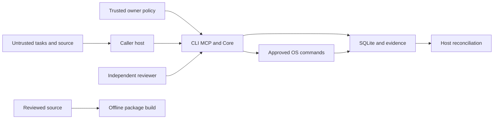

# Local alpha threat model

## Executive summary

The highest-impact paths cross from untrusted task/source data into approved OS
execution, or from mutable local evidence into acceptance. This Python CLI/stdio
MCP toolkit is designed for a trusted owner and cooperative same-user workers.
Checks provide auditability and fencing, not isolation against a hostile same-user
process. It is not an internet service or multi-tenant platform.

## Scope and assumptions

Scope: agent_workflow runtime, local SQLite state, owner configuration, logs,
receipts, source checkout and offline distribution tooling. Owner-confirmed context
is local single-user development, no publication credentials, no external model/API
calls authorized by installation, no network service. Optional runner/evolution
adapters need separate explicit authority. The owner confirmed TIM copyright and
GitHub-only private vulnerability reporting, and approved the minimal public source
repository. Actual private-reporting activation remains unverified. A future
hosted or hostile-worker deployment needs a new model and OS isolation design.

## System model

### Primary components

`cli.py`/`__main__.py` and `mcp.py` call `core.Engine`; `core.py` uses SQLite and
immutable run snapshots. `core_process.py`/`guardian.py` execute configured argv.
`quality.py` validates independent owner assessments; `continuation.py` and
`hostbridge.py` journal owner resources and caller-side dispatch/reconciliation.
`context.py`, `research.py`, `handoff.py` and `experience.py` return bounded inert
data. Optional `runner.py` invokes external backends only under separately supplied
policy. `pyproject.toml` builds distribution files; tests/portable are controlled
native fixtures, separate from actual AI or production operation.

### Data flows and trust boundaries

- Task/feedback/source → CLI/MCP/Core: JSON/stdin/files; schema and content checks
  validate shape, not truth or user intent. No network authentication is provided
  by stdio. Host permissions and reviewed policy remain separate.
- Owner → Core/state: reviewed local config, tests and permission/budget snapshots;
  SQLite transactions and tokens fence supported mutations (`core.py`). Same-user
  filesystem writes can bypass these cooperative checks.
- Core → OS subprocess: fixed owner argv and filtered child environment, byte/log
  caps, original lease/deadline and process-group guardian (`core_process.py`,
  `guardian.py`). Deliberate escaped sessions or a killed guardian remain risks.
- Verifier/reviewer → acceptance: command exits, source/controller digests, logs
  and independent assessment (`core.Engine.verify/transition`, `quality.py`).
  Hash identity is not a signature or proof against malicious local replacement.
- Host → Continuation/HostBridge: inert durable requests and actual run/event
  reconciliation (`continuation.py`, `hostbridge.py`), with original resources;
  no internal platform API dispatch. Current projection/version identity matters.
- Source → build/install: setuptools metadata/data-files; offline builds run in
  owned copies. CI is reviewed configuration, not evidence of remote execution.

#### Diagram

## Assets and security objectives

| Asset | Why it matters | Objective |
|---|---|---|
| Source and controller | Changed code must not inherit stale proof | Integrity |
| Owner tests/permissions/budgets | Defines executable authority and resource limits | Integrity, availability |
| SQLite/events/receipts | Recovery and acceptance depend on exact history | Integrity, availability |
| Claim tokens/private logs | Tokens grant owned mutation; logs may reveal source/secrets | Confidentiality |
| Distribution artifacts | Users execute installed package contents | Integrity |

## Attacker model

### Capabilities

An untrusted feedback author can submit misleading text or malicious instructions.
A repository contributor can modify source/test candidates presented for review.
A local cooperative worker can make mistakes, crash or repeat a request; same-user
hostile writes are possible but outside the enforced trust guarantee.

### Non-capabilities

This alpha exposes no public HTTP endpoint or cross-tenant access model. A remote
feedback author is not assumed to possess OS access, owner approval, claim tokens
or publication credentials. Native fault fixtures do not prove real-world hostile
isolation or indefinite unattended recovery.

## Entry points and attack surfaces

| Surface | Boundary | Evidence |
|---|---|---|
| CLI args/stdio tools | Host data into shared Core | cli.py, mcp.py |
| Import/research/context | Untrusted text and files into inert records | core.py import_task, research.py, context.py |
| Config/tests/processes | Owner policy into OS execution | core.py, core_process.py, guardian.py |
| Independent assessment/receipt | Evidence into acceptance/reconciliation | quality.py, receipt.py, hostbridge.py |
| Local DB and runtime files | Same-user filesystem into trusted identity | continuation.py, core.py |
| Build metadata/fixtures/CI | Developer source into installed artifact | pyproject.toml, MANIFEST.in, tests/portable, .github/workflows |

## Top abuse paths

1. Malicious feedback asks a worker to alter tests or publish → worker treats data
   as authority → unauthorized code/credential use. Require owner-reviewed scope.
2. Contributor weakens tests then claims green → same-user artifacts look valid →
   false acceptance. Review full diffs and exact frozen test identities independently.
3. Old logs/assessment copied to changed code → stale acceptance → incorrect
   integration. Keep source/controller/policy/request binding and fresh proof.
4. Approved command accesses local credentials or escapes its process group →
   data loss or overlap. Keep credentials separate and use OS isolation for hostile
   commands; process cleanup alone is insufficient.
5. Token/log/archive leaks through packaging → mutation authority or source leaks.
   Store handles privately outside source, inspect package allowlists and logs.
6. Repeated dispatch after a lost reply → duplicate work or spent-budget bypass.
   Observe actual durable run/events; preserve unknown outcomes and original caps.

## Threat model table

| ID | Source/prerequisite | Action and impact | Existing controls | Gaps/recommendation/detection | Likelihood | Impact | Priority |
|---|---|---|---|---|---|---|---|
| TM-001 | Untrusted feedback; host mistakes data for instructions | Escalate scope into OS command or release | inert records, fixed config in core.py/research.py | Host must enforce user scope; inspect command/policy diffs | medium: plausible prompt injection | high: user OS access | high |
| TM-002 | Same-user writer or careless reviewer | Weaken tests/DB/evidence and falsely accept | source hashes/run fencing/quality.py | No hostile tamper resistance; independent source/test review, separate OS accounts when needed | medium: cooperative errors possible | high: invalid artifact | high |
| TM-003 | Stale assessment or lost reply | Reuse proof or duplicate dispatch | continuation.py/hostbridge.py exact identities and journals | Cooperative snapshots not atomic hostile isolation; retain failed/unknown states, inspect history | medium: crash/retry plausible | medium: wasted work/stale approval | medium |
| TM-004 | Owner-approved hostile command | Read credentials, escape cleanup, corrupt files | filtered env, capped logs, guardian.py process groups | OS rights unchanged; isolate untrusted code externally and keep credentials separate | low under trusted-command assumption | high: local data exposure | medium |
| TM-005 | Careless artifact author | Ship tokens/private logs or malicious distribution | explicit packaging/data allowlist and offline QA | Scans do not prove absence; manually review manifests and private handles | medium: packaging error plausible | high: credential/source exposure | high |
| TM-006 | Resource-heavy input or duplicate request | Exhaust disk/time or exceed intended work | byte caps, deadlines, attempts, reservation journal | Not a network rate limiter; monitor exact byte totals and spent resources | medium: ordinary failure path | medium: local availability | medium |

## Criticality calibration

Critical means a demonstrated path bypassing the assumed owner/OS trust boundary
with broad credential/code execution impact (for example unauthorized public service
RCE or cross-tenant access); neither service exists in this scope. High covers
unauthorized OS execution or false acceptance/credential distribution. Medium
covers bounded resource loss, stale reconciliation requiring diagnosis or local
command escape under changed trust assumptions. Low covers inert metadata confusion
or recoverable disclosure of nonsensitive status. Ratings depend most on trusted
owner commands, same-user cooperation and absence of public network exposure.

## Focus paths for security review

| Path | Focus | Threats |
|---|---|---|
| agent_workflow/core.py | Tokens, exact run ownership, source-bound verification and transitions | TM-001/002/003 |
| agent_workflow/core_process.py, guardian.py | Exec errors, cutoffs, process groups and log capture | TM-004/006 |
| agent_workflow/quality.py | Trusted reviewer/source/proof/coverage validation | TM-002/003 |
| agent_workflow/continuation.py, hostbridge.py | Original resources, durable intents, exact event recovery | TM-003/006 |
| agent_workflow/context.py, research.py | Containment, bounded input, inert feedback and secret handling | TM-001/005 |
| pyproject.toml, MANIFEST.in | Distribution allowlist and installed data | TM-005 |

## Notes on use

Review covered CLI/MCP, owner config, files/DB, subprocesses, assessments, optional
host adapters and build/CI boundaries. Runtime and test/build behavior are distinct.
Known local-only assumptions came from the owner-authorized scope, not inferred
internet service guarantees. Public source publication was approved; this does not
establish that GitHub private reporting has actually been enabled.
This is a repository-grounded design review, not a penetration test or proof that
no vulnerabilities or secrets exist. Revisit before any deployment-model change.
